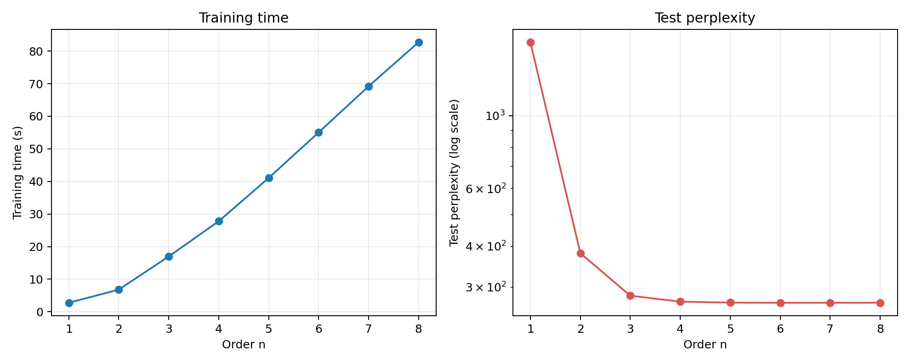
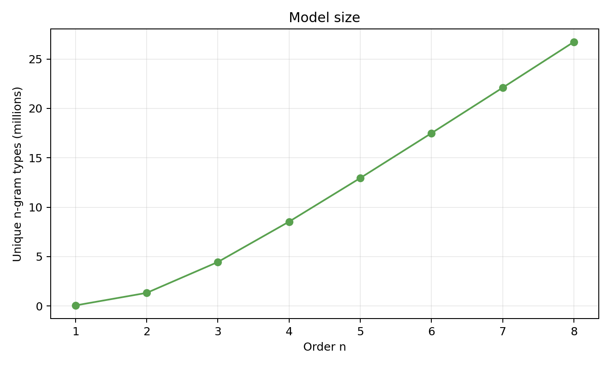
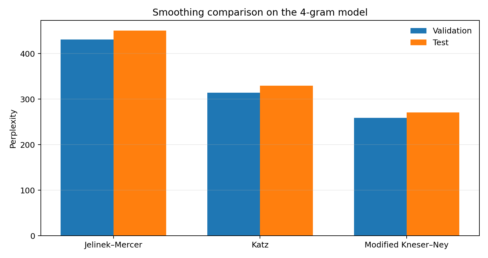

# 人民日报切分语料 n-gram 语言模型实验报告

## 摘要

本实验使用人民日报 1998 年上半年分词标注语料，清除记录编号和读音标注后，按月份划分训练集、验证集和测试集。主实验比较 Modified Kneser–Ney 平滑下 n=1 至 8 的模型规模、训练时间与困惑度，并在四元模型上比较 Jelinek–Mercer、Katz 和 Modified Kneser–Ney 三种平滑方法。测试结果显示，困惑度由一元模型的 1675.78 降至六元模型的 268.76；七元和八元模型没有带来进一步改善。模型规模随阶数增加，训练时间总体增加但存在单次测量波动。

## 一、实验目的

实验考察语料标注清理对语言模型训练的必要性，比较不同 n 值下的模型效果与训练开销，并观察平滑方法对测试困惑度的影响。此外，使用指定开头进行续写，观察不同模型阶数和解码参数组合下生成文本的差异。

## 二、语料处理与数据划分

原始语料由六个按月保存的 GBK 文本文件组成，文件已按空格切分词语。每条记录以编号开头，部分词语附有花括号读音标注。编号不是正文词项，读音标注也不是正文内容；若保留它们，编号会形成无意义的词项，读音标注则会把同一词语拆成不同形式，并可能直接出现在生成文本中。因此，清理时删除编号、花括号标注和尖括号标签，保留原有词语切分、标点和记录边界。

**表 1 语料清理统计**

| 处理项目 | 数量 | 处理结果 |
|---|---:|---|
| 原始文本行 | 143,766 | 按记录逐行处理 |
| 保留记录 | 123,761 | 每条记录单独建模，不跨记录拼接上下文 |
| 行首记录编号 | 123,761 | 全部删除 |
| 花括号读音标注 | 95,087 | 全部删除 |
| 尖括号标签 | 0 | 未检出 |
| GBK 解码异常字符 | 6 | 对应词元统一替换为 `<UNK>` |
| 清理后词元 | 7,310,182 | 保留分词和标点 |

运行实验脚本后，清理后的逐月文本保存在 `ngram_experiment/data/`。数据按时间顺序划分，以降低相邻记录随机混合造成的信息泄漏。

**表 2 数据集划分情况**

| 数据集 | 月份 | 记录数 | 清理后词元数 |
|---|---|---:|---:|
| 训练集 | 1998 年 1–4 月 | 81,197 | 4,811,395 |
| 验证集 | 1998 年 5 月 | 21,421 | 1,247,053 |
| 测试集 | 1998 年 6 月 | 21,143 | 1,251,734 |

词表仅根据训练集建立，最低词频设为 2，共 63,795 项，包含 `<UNK>`、句首和句末符号。训练集中 50,586 种只出现一次的普通词映射为 `<UNK>`；验证集和测试集未登录词率分别为 2.27% 和 2.26%。评估时每条记录末尾均计入句末符号。

## 三、模型与实验设置

主实验训练 n=1 至 8 的 Modified Kneser–Ney 模型。一元模型作为不使用上下文信息的词频基线。高阶模型采用对应阶数的原始计数，低阶分布使用左侧续接计数，并依据训练计数的频次分布估计折扣量。对低频词采用 `<UNK>` 归并，减轻词表外事件造成的零概率。

模型效果以困惑度衡量，数值越低表示模型对测试文本的平均预测概率越高。训练时间记录从计数表构建开始至平滑模型拟合结束，包含训练集计数和模型拟合，不包含语料清理、词表构建、验证、测试和文本生成。各阶均独立运行一次，运行过程记录于 `ngram_experiment/results/training.log`。模型规模以各阶累计的不同 n-gram 项数表示，不将其等同于序列化文件大小。

平滑方法对比固定使用四元模型、同一训练集和词表。Jelinek–Mercer 的 λ 在验证集上从 0.2、0.4、0.6、0.8 中选择；Katz 回退采用 Good–Turing 频次折扣，对计数 1–6 估计并截断折扣值，其他计数按脚本设定处理；Modified Kneser–Ney 使用分段折扣和续接计数。测试集只用于最终报告，不参与参数选择。

## 四、实验结果

### 4.1 不同阶数的训练与评估

**表 3 不同阶数模型的训练与评估结果**

| 阶数 n | 累计不同 n-gram 项数 | 训练时间（秒） | 验证困惑度 | 测试困惑度 |
|---:|---:|---:|---:|---:|
| 1 | 63,794 | 2.76 | 1653.81 | 1675.78 |
| 2 | 1,332,509 | 6.79 | 371.27 | 380.65 |
| 3 | 4,457,083 | 16.97 | 271.25 | 282.35 |
| 4 | 8,539,727 | 27.77 | 258.89 | 270.95 |
| 5 | 12,955,114 | 41.05 | 256.72 | 268.99 |
| 6 | 17,497,147 | 55.02 | 256.47 | 268.76 |
| 7 | 22,097,780 | 69.17 | 256.48 | 268.77 |
| 8 | 26,730,351 | 82.71 | 256.53 | 268.82 |



**图 1 不同 n 值下的训练时间与测试困惑度**

左图显示，训练时间由 n=1 的 2.76 秒增加到 n=8 的 82.71 秒，整体随阶数上升；右图显示，从一元提升到二元、三元模型后，测试困惑度明显下降，说明上下文信息改善了词语预测。四元至六元模型继续带来小幅改善，六元模型取得最低测试困惑度 268.76。七元和八元模型的测试困惑度分别为 268.77 和 268.82，较六元模型略高，表明在当前语料规模和词表下，增加上下文长度已不能稳定改善泛化效果。

### 4.2 模型规模



**图 2 不同 n 值下的模型规模**

累计 n-gram 项数从一元模型的 63,794 增至八元模型的 26,730,351，约为 419.0 倍；本次运行的训练时间从 2.76 秒增至 82.71 秒，约为 30.0 倍。六元增至八元后，测试困惑度由 268.76 升至 268.82，模型项数和训练开销仍继续增长。该规模指标反映计数表中的不同 n-gram 条目数，不代表模型在磁盘上的字节大小。

### 4.3 四元模型的平滑方法

**表 4 四元模型的平滑方法对比**

| 平滑方法 | 参数 | 验证困惑度 | 测试困惑度 | 测试零概率事件 |
|---|---|---:|---:|---:|
| Jelinek–Mercer | λ=0.2 | 431.04 | 450.61 | 0 |
| Katz 回退 | Good–Turing 折扣 | 314.22 | 329.29 | 906 |
| Modified Kneser–Ney | 分段折扣与续接计数 | 258.89 | 270.95 | 0 |



**图 3 四元模型的平滑方法比较**

在本次参数设置下，Modified Kneser–Ney 在验证集和测试集上均取得最低困惑度。Jelinek–Mercer 的验证集最优参数为 λ=0.2。Katz 的测试困惑度高于另外两种方法；该结果对应本实验使用的 Good–Turing 折扣范围和回退实现，不应据此推断 Katz 方法在所有语料和参数下均较差。JM 和 MKN 未出现零概率测试事件，Katz 出现 906 个；为得到有限困惑度，评估程序仅对零概率事件使用 10⁻¹² 数值下限，因此 Katz 结果应结合零概率事件数一并解读。

### 4.4 文本续写

续写提示为“在阳光明媚的五月，我们学校胜利召开了……”，按训练语料的分词方式输入。生成使用固定随机种子，最多生成 60 个词元；为避免模型在提示后立即输出句末符号，至少生成 12 个词元后才允许结束。采样候选限制为训练词频最高的 1,000 个词元及 `<UNK>`、句末符号。四元模型额外展示三组解码参数，其中 `temperature` 和 Top-k 同时变化；这些样例用于观察不同参数组合的输出差异，不用于判断某一个参数的独立作用。以下列出实际输出的节选。

| 模型与参数 | 续写节选 |
|---|---|
| 1-gram，`temperature=0.8`，Top-k=20 | 的 了 为 ， <UNK> 、 、 ， ， 的 在 ， 的 的 和 不 的 ） ， 了 是 ， |
| 2-gram，`temperature=0.8`，Top-k=20 | 一 天 不 是 我国 在 新 的 。 ” 。 他 的 ， <UNK> 美元 ， 中国 的 经济 工作 ， 使 企业 要 有 一个 多 名 。 |
| 4-gram，`temperature=0.8`，Top-k=20 | 。 但 要 看到 它 的 人 ， 都 有 “ <UNK> ” ， 为 维护 稳定 了 ， 而 这 一 点 ， 又 是 一个 ， 但 结果 ， 使…… |
| 4-gram，`temperature=1.0`，Top-k=1 | 十五大 精神 ， 坚持 “ 一个 中国 ” 的 政策 ， 在 国际 上 的 地位 和 作用 ， 在 人民 群众 中 的 形象 和 对 国家 、 对 人民 的…… |
| 4-gram，`temperature=1.3`，Top-k=40 | 全国 ， 而且 在 人员 对 自己 的 <UNK> 。 目前 ， 他们 在 。 然而 ， 美国 的 关系 以及 中国 的 一 只 小 ” 了 ， 也 是 社会主义…… |
| 8-gram，`temperature=0.8`，Top-k=20 | 全省 商业 中心 ， 实行 改革 开放 的 基本 实践 中 ， 以 <UNK> ， 我 在 全 市 人民 生活 水平 提高 的 新 的 历史 。 （ 新华社 记者 赵…… |

一元模型主要依赖词频，生成内容缺少上下文衔接。四元模型在不同解码参数组合下产生了不同续写；由于 `temperature` 和 Top-k 同时变化，不能据此单独判断某一参数的作用。较高阶模型能够利用更长的局部历史，但仍不能保证长距离语义连贯。出现 `<UNK>` 的位置对应训练词表中的低频或异常词元。

## 五、结论

实验完成了人民日报切分语料的标注清理，并在一致的数据划分和词表下比较了 n=1 至 8 的 Modified Kneser–Ney 模型及四元模型的三种平滑方法。模型阶数提高显著改善了一元基线的预测效果，但计数表规模持续增长，训练时间总体增加并受到单次运行负载影响。六元模型取得本次实验最低测试困惑度；七元和八元模型的结果略有回升，因此继续增加阶数在本语料和当前词表设置下收益有限。平滑方法比较中，Modified Kneser–Ney 的测试困惑度最低。生成实验显示，n-gram 模型适于学习局部词语统计规律，但仅凭有限上下文难以生成结构连贯的长文本。

## 六、实现环境与复现

本实验需要 Python 3.10 或更新版本及 Matplotlib 3.8.4。实验使用 Python 脚本实现 n-gram 计数、Modified Kneser–Ney、Jelinek–Mercer 和 Katz 概率计算及文本生成，Matplotlib 用于绘图。训练时间为单次测量，可能随运行环境和系统负载变化。运行后，实验结果、训练日志、清理后语料和图片分别保存在 `ngram_experiment/results/`、`ngram_experiment/data/` 和 `ngram_experiment/figures/`。

复现实验时，需将 `run_ngram_experiment.py` 和原始语料目录 `raw_data/` 保存在同一项目目录中，再运行：

```powershell
python -m pip install -r requirements.txt
python run_ngram_experiment.py
```

主实验脚本为 [run_ngram_experiment.py](run_ngram_experiment.py)，结构化数据见 [experiment_results.json](ngram_experiment/results/experiment_results.json)，训练过程见 [training.log](ngram_experiment/results/training.log)。
